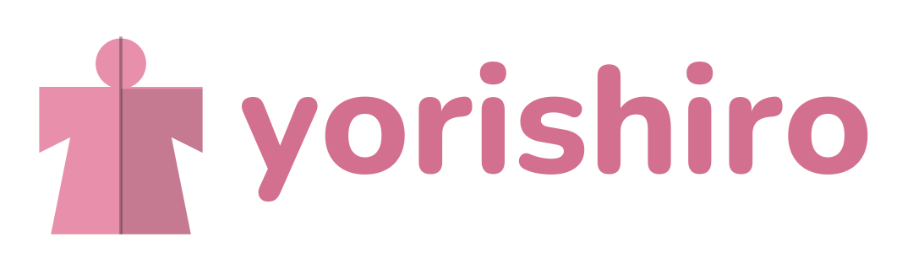
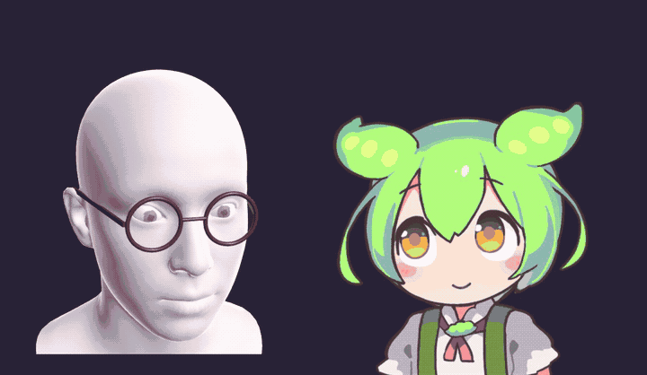
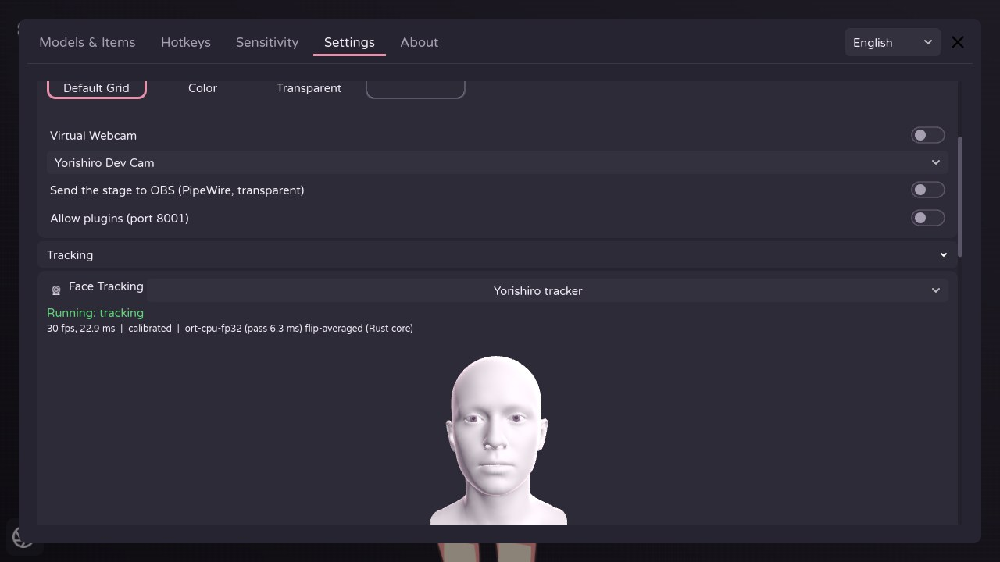
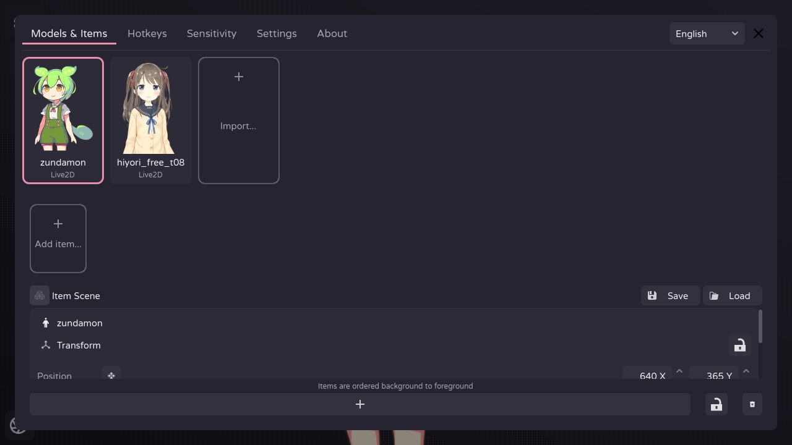
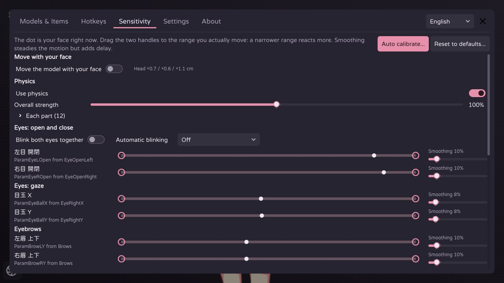
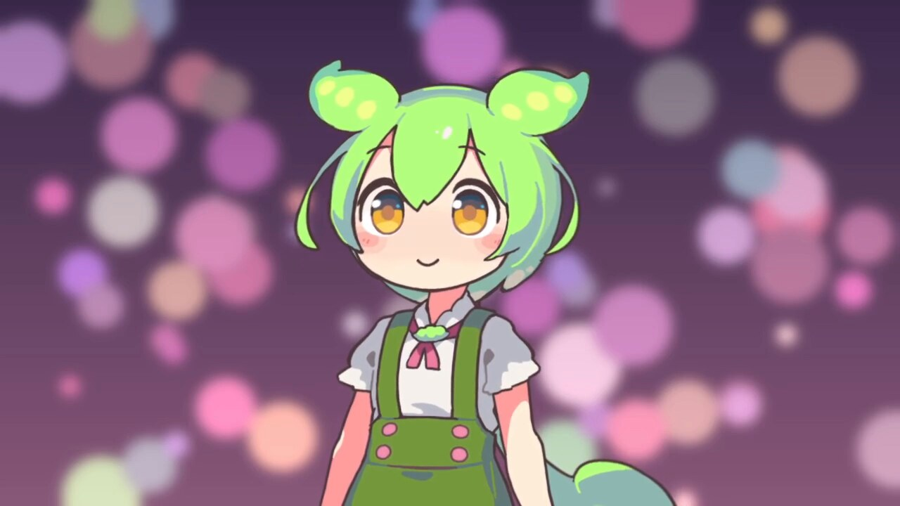

<p align="center">
  
</p>

<p align="center">Linux 用の Live2D VTuber アプリ。GPU で動く独自のフェイストラッカー付き。</p>

<p align="center"><a href="README.md">English</a> · <a href="README.zh-TW.md">繁體中文</a></p>



> 開発者はウインクがあまり上手ではありません。ごめんなさい。

**Yorishiro は開発の初期段階です。粗い部分や、互換性のない変更があります。**

## 機能

- **Live2D モデル。** モデルに付いてくる設定（パラメーターの割り当て、ホットキー、物理演算、待機アニメーション）を
  そのまま読み込みます。描画は Katashiro が担当します。独立した Live2D レンダラー
  [Ayagami](https://github.com/AyagamiDev/ayagami) の Godot バインディングを私たちがフォークしたもので、Live2D Cubism SDK は含みません。
- **フェイストラッキング内蔵。** アプリが自分のトラッカーを起動します。MediaPipe FaceMesh のランドマークを
  ARKit の 52 個の表情に当てはめ、合成した目の画像で学習した目のモデル（画面が映り込むメガネ越しでも動きます）、
  視線、頭の位置を出します。Vulkan であらゆる GPU で動き、CPU でも動きます。
- **ハンドトラッキング。** オプションで、顔と同じ GPU ランタイムで並行して動きます。手の位置、角度、開き具合、
  指 1 本ずつを、手のリグを持つ Live2D モデルが使う入力として出します。
- **カメラの映像を画面に出さない。** トラッカーが見ているものは 3D の頭で表示するので、設定画面がうっかり配信に
  映っても部屋は映りません。メガネに気づくと頭にもメガネをかけ、ハンドトラッキング中は粘土の手も表示します。
- **モデルを自分の顔に合わせる。** ガイド付きのキャリブレーション、パラメーターごとの範囲とスムージング、
  両目を一緒にまばたき、自動まばたき、顔に合わせた移動、トラッキングを見失ったときの動作、部位ごとの物理演算の強さ。
- **ホットキー、表情、アイテム。** ホットキー一覧と画面ボタン、表情の切り替え、Live2D のポーズグループ、
  画像やアニメーションのアイテムライブラリ、アイテムシーン。
- **背景を透過して OBS へ。** ステージを、アプリのボタンやメニューを除いて、アルファ付きの PipeWire 映像として
  OBS に送ります。v4l2loopback の仮想カメラ（アルファがないのでアプリの背景が映ります）や、透過ウィンドウも使えます。
  設定方法は[ガイドの OBS の章](docs/guide.ja.md#obs)へ。
- **他のアプリにトラッキングを送る。** トラッカーのデータを、よく使われるフェイストラッキングのプロトコル
  （iFacialMocap と、他の VTuber アプリが読む iPhone トラッキングのプロトコル）でも送れます。
- **プラグイン。** VTuber 用プラグインがすでに使っているメッセージ形式のローカル WebSocket API（ポート 8001、
  初期設定はオフ）。モデルの移動、ホットキーや表情の実行、トラッキング値の送信ができます。各プラグインは接続前に
  一度だけ許可を求めます。
- **日本語、英語、繁体字中国語**の UI。

| | |
|---|---|
|  |  |
| フェイストラッキングの設定。3D の頭があなたの顔をまねし、カメラの映像は画面に出ません。 | モデルとアイテム。サムネイルはステージから撮ったもの。 |
|  |  |
| 感度、顔に合わせた移動、部位ごとの物理演算。 | PipeWire で OBS に送ったステージ。モデルの周りは透過しています。 |

※ スクリーンショットは英語の UI です。

## 動作環境

- x86_64 の Linux と、Vulkan 対応の GPU（AMD と Intel は Mesa、NVIDIA は公式ドライバー）。リリース版
  （`tools/make_release.sh` で作る AppImage と tar.gz）には Ubuntu 24.04、Linux Mint 22、Fedora 39、Debian 13
  以降（glibc 2.38）が必要です。
- Web カメラ。
- キーボードのホットキーは、アプリのウィンドウがフォーカスされている間に使えます。他のウィンドウからも使うには、
  ユーザーを `input` グループに追加して（`sudo usermod -aG input $USER`）、ログインし直してください。実行する
  すべてのプログラムがキーボードを読めるようになるので、必要なときだけにしてください。
- PipeWire で OBS に送るには：PipeWire 1.4 以降（ビルドと実行の両方）、Vulkan レンダラー（初期設定）、OBS 32 以降と、
  別プロジェクトの [obs-pwvideo](https://github.com/hoshinolina/obs-pwvideo) プラグイン（[リリース](https://github.com/hoshinolina/obs-pwvideo/releases)から
  ダウンロード）。ディストリビューションの OBS と Flatpak 版それぞれの入れ場所は[ガイド](docs/guide.ja.md#obs)にあります。
  Ubuntu 26.04（PipeWire 1.6）、25.10、Debian 13 は最初から条件を満たすので、背景を透過して配信するなら
  Ubuntu 26.04 をおすすめします。Ubuntu 24.04 と Linux Mint 22 の PipeWire は 1.0 なので、PipeWire を更新しない限り、
  アプリは動きますが OBS への出力は使えません。

## ダウンロード

[Releases](https://github.com/koshizuow/yorishiro/releases) から、次のどちらかを：

- **AppImage**（ファイル 1 つ）：`chmod +x Yorishiro-<version>-x86_64.AppImage` してから実行します。libfuse2 は
  不要です。システムから使うのは fuse3 パッケージの `fusermount3` だけで、これらのディストリビューションの
  デスクトップ環境には入っています。各リリースは、素の Ubuntu 24.04、Fedora 39、Arch、openSUSE Tumbleweed で
  この方法で起動を確認しています（`tools/release/check_appimage.sh`）。Gear Lever や AppImageUpdate などの
  AppImage ツールでアプリケーションメニューへの追加や更新ができ、更新では変わった部分だけをダウンロードします。
- **tar.gz**：展開して、中の `./yorishiro.x86_64` を実行します。

どちらにもトラッキングモデルが入っています。設定とモデルライブラリは `~/.local/share/yorishiro/` に保存されます。

`SHA256SUMS-<version>` はファイルのチェックサムの一覧で、0.1.5 からは [minisign](https://jedisct1.github.io/minisign/)
で署名しています（`SHA256SUMS-<version>.minisig`）。ダウンロードを確認するには、この 2 つのファイルと同じフォルダーに
置いて、次を実行します：

```
minisign -Vm SHA256SUMS-<version> -P RWRyX8UU0kziEAs5Y8oGD0H65bYpzq/Jm0OhisWCRrlih/ldW/N9qgvi
sha256sum -c --ignore-missing SHA256SUMS-<version>
```

GitHub でビルドしたリリースにはビルドの来歴証明（attestation）も付いています。`gh attestation verify <file> -R koshizuow/yorishiro`
で、そのファイルをビルドしたコミットとワークフローを確認できます。

## ビルド

1. **エンジン。** Linux 用の公式 [Godot 4.7.2](https://godotengine.org/download/archive/4.7.2-stable/) エディター
   （x86_64、standard 版、.NET 版ではない）。リポジトリの隣の `../tools/godot/` に展開すると `run.sh` が見つけます。
   または `GODOT=/path/to/godot` を指定します。
2. **システムパッケージ**（Debian / Ubuntu の名前）：
   `sudo apt install libudev-dev libinput-dev libclang-dev pkg-config cmake ninja-build libpipewire-0.3-dev libgbm-dev libdrm-dev libvulkan-dev`
3. **Rust** 1.94 以降を [rustup](https://rustup.rs) で（ディストリビューションのパッケージは古いことが多いです）。
4. **ネイティブ拡張：**
   ```sh
   git submodule update --init
   cd app && ./build_dependencies.sh && cd ..
   ```
   初回のビルドでは [ncnn](https://github.com/Tencent/ncnn)（GPU ランタイム、約 5 分）もビルドし、
   [ONNX Runtime](https://github.com/microsoft/onnxruntime) の CPU 版をダウンロードします。
5. **トラッキングモデル**を `models/` に（`models/README.md` を参照）：リリースの tar.gz の `models/` フォルダーを
   コピーするか、研究用ツールで元のファイルから作ります（Python 3.12 の環境は [uv](https://docs.astral.sh/uv/) が管理します）：
   ```sh
   cd research
   uv sync
   uv run python tools/export_mediapipe.py   # 顔のモデル
   uv run python tools/export_hands.py       # 手のモデル
   uv run python tools/export_fit.py         # ARKit の表情の当てはめ
   cd ..
   ```
6. **プロジェクトを一度インポート：** `./run.sh --headless --import`

## 使い方

ホットキー、OBS、仮想カメラなどの手順は[ガイド](docs/guide.ja.md)にあります。

AppImage（または tar.gz の `./yorishiro.x86_64`）を起動します。ソースからビルドした場合は `./run.sh` です。

- UI の言語は、設定画面の右上で切り替えられます。
- 初回起動時はステージ中央のカードが案内します。モデルを選び、フェイストラッキングを確認し、モデルを配置します。
- Live2D モデルは `.model3.json` ファイルのあるフォルダーです。付いてくる設定は読むだけで、変更はしません。
  `userdata/yorishiro/Live2DModels/` にあるモデルは自動で表示されます。
- トラッカーはアプリと一緒に起動します。少しの間、力を抜いた顔でカメラをまっすぐ見ると、それを自然な表情として
  記録します。感度ページの**自動キャリブレーション**も使えます。
- モデルはドラッグで移動、スクロール（タッチパッドではピンチ）で拡大縮小、Shift を押しながらスクロールで回転します。
  隅の歯車からすべての設定を開けます。
- **OBS：** 設定で「ステージを OBS に送る」をオンにし、OBS で「PipeWire video」ソースを追加して Yorishiro を選びます。
  先に OBS に obs-pwvideo プラグインが必要です。入れ方は[ガイドの OBS の章](docs/guide.ja.md#obs)へ。
- ソースから動かしている間、アプリのデータ（設定、モデルライブラリ、サムネイル）は `userdata/yorishiro/` に保存されます。
- **1 台のパソコンで複数人：** アプリをもう一度開きます。各コピーは次の番号を使い（`--instance=2` で指定も可）、
  それぞれの設定、空いているカメラ、専用の OBS ストリーム（`Yorishiro-2`）とプラグインのポート（8002）を持ちます。
  モデルライブラリは共有です。2 つのコピーが同じカメラを読むことはできません。各コピーがトラッキングと描画を
  それぞれ行うので、その分の CPU とグラフィックメモリを見込んでください。
- Wayland でウィンドウが出るまで 1 分ほどかかる場合は、デスクトップポータルが応答していません。Godot は起動時に
  ポータルに問い合わせ、1 回ごとに 25 秒待ちます。お使いのデスクトップのポータルのバックエンド
  （例：`xdg-desktop-portal-wlr`、`xdg-desktop-portal-hyprland`）を入れて起動してください。

## リポジトリ

| ディレクトリ | 内容 | ライセンス |
|-----------|------|---------|
| `app/` | Yorishiro アプリ（Godot）。erodozer の [OpenVT](https://github.com/erodozer/open-vt) のフォークから始まりました | MIT、`app/LICENSE.txt` を参照 |
| `crates/tracking`、`crates/tracking-gd` | Rust のフェイストラッキングコアと、その Godot ノード | Apache-2.0、`crates/tracking/LICENSE` を参照 |
| `crates/pipewire-gd` | libfunnel を使い、グラフィックカード上でステージを PipeWire 経由で OBS に送ります | Apache-2.0、`crates/pipewire-gd/LICENSE` を参照 |
| `crates/katashiro`、`crates/katashiro-gd` | Live2D レンダラーの Katashiro：[Ayagami](https://github.com/AyagamiDev/ayagami) とその Godot バインディングのフォーク | MIT または Apache-2.0（コア）、MIT（Godot 部分） |
| `crates/virtualcamera-gd` | ステージを v4l2loopback のカメラに送ります：erodozer の [gd-virtualcamera](https://github.com/erodozer/gd-virtualcamera) を複製して変更したもの | Unlicense、`crates/virtualcamera-gd/LICENSE.md` を参照 |
| `thirdparty/` | ビルドに使う上流のコード：[libfunnel](https://github.com/hoshinolina/libfunnel)、godot-keylogger | それぞれのライセンス |
| `models/` | トラッキングモデル（作るかダウンロードする。git に入っているのは目のモデルだけ） | `models/README.md` を参照 |
| `research/` | トラッキングモデルを作る Python ツールと、目のモデルの学習 | Apache-2.0、`research/LICENSE` を参照 |
| `tools/` | 開発とテストのツール | 属する部分と同じ |

スクリーンショットのモデルはこのプロジェクトやそのライセンスには含まれません。[画像のクレジット](#画像のクレジット)を参照してください。

Yorishiro は独立したプロジェクトです。上流の OpenVT、Ayagami、libfunnel のプロジェクトではなく、それらの作者の
承認も受けていません。問題はこちらに報告してください。ライセンスの詳細とサードパーティの一覧：[NOTICE](NOTICE)。

## 画像のクレジット

スクリーンショットのモデルは Live2D のサンプルモデル、ずんだもん（イラスト：坂本アヒル、モデリング：株式会社Live2D）と
桃瀬ひより（株式会社Live2D）です。
本作品のキャラクターには株式会社Live2Dの著作物であるサンプルデータが株式会社Live2Dの定める規約に従って用いられています。
ずんだもん：東北ずん子・ずんだもんプロジェクト。モデルのファイルはこのリポジトリに含まれません。
[Live2D のサンプルデータのページ](https://www.live2d.com/learn/sample/)から入手してください。

「Live2D」と「Cubism」は株式会社Live2Dの商標です。Yorishiro は株式会社Live2Dとは関係ありません。
