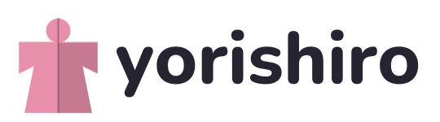

<p align="center">
  <picture>
    <source media="(prefers-color-scheme: dark)" srcset="docs/images/logo-wordmark-dark.svg">
    
  </picture>
</p>

<p align="center">Live2D VTubing for Linux, with its own GPU face tracker.</p>

<p align="center"><a href="README.zh-TW.md">繁體中文</a></p>


> Yorishiro is in early development. Expect rough edges and breaking changes.

## Features

- **Live2D models, VTube Studio style.** Models load with their VTube Studio settings (`.vtube.json`
  parameter bindings, hotkeys, physics, idle animation). Rendering by [Ayagami](https://github.com/AyagamiDev/ayagami),
  an independent Live2D renderer: no Live2D Cubism SDK inside.
- **Face tracking built in.** The app starts its own tracker: MediaPipe FaceMesh landmarks fitted to the 52
  ARKit expressions, an eye model trained on synthetic eyes (holds up behind glasses that reflect the
  screen), gaze, head position. Runs on any GPU through Vulkan, on NVIDIA through CUDA or TensorRT, or on the CPU.
- **No camera picture on screen.** A 3D head shows what the tracker sees, so a slip of the settings window
  never shows your room on stream. It even puts on glasses when it notices yours.
- **Tune the model to your face.** Guided calibration, range and smoothing per parameter, both eyes blinking
  together, automatic blinking, follow-the-face movement, what to do when tracking is lost, physics strength
  per part.
- **Hotkeys, expressions and items.** A hotkey list and on-screen buttons, expression toggles, Live2D pose
  groups, an item library for pictures and animations, item scenes.
- **Into OBS with a transparent background.** The stage goes to OBS as a PipeWire video stream with alpha,
  without the app's buttons and menus. A v4l2loopback virtual camera and a transparent window work too.
- **Tracking for other apps.** Yorishiro can stand in for an iPhone running VTube Studio, or send
  iFacialMocap data to VSeeFace, Warudo and VNyan.
- **English and Traditional Chinese** interface.

| | |
|---|---|
|  |  |
| Face tracking settings. The 3D head mirrors your face, the camera picture stays off screen. | Models and items, with thumbnails taken from the stage. |
|  |  |
| Sensitivity, follow-the-face and physics per part. | The stage in OBS through PipeWire, transparent around the model. |

## Requirements

- Linux on x86_64 with a Vulkan capable GPU (AMD and Intel through Mesa, NVIDIA with its driver).
- A webcam.
- For the PipeWire output to OBS: PipeWire 1.4 or newer for building (1.2 or newer at run time on NVIDIA),
  OBS 31 or newer with the [obs-pwvideo](https://github.com/hoshinolina/obs-pwvideo) plugin.

## Build

The app runs on a Godot 4.7.1 build with Ayagami's blend mode patch, published by the Ayagami project.

1. **Engine.** Download `godot.linuxbsd.editor.x86_64.llvm` from the `godot` release of
   [AyagamiDev/ayagami-gd](https://github.com/AyagamiDev/ayagami-gd/releases/tag/godot) and check its sha256.
   `run.sh` looks for it in `../tools/godot/` next to the repository, or set `GODOT=/path/to/godot`.
2. **System packages** (Debian / Ubuntu names):
   `sudo apt install libudev-dev libinput-dev libclang-dev pkg-config meson ninja-build libpipewire-0.3-dev libgbm-dev libdrm-dev libegl-dev libgl-dev libx11-dev`
3. **Rust** 1.94 or newer through [rustup](https://rustup.rs) (distribution packages are often older).
4. **Native addons:**
   ```sh
   git submodule update --init
   cd app && ./build_dependencies.sh && cd ..
   ```
5. **Tracker** ([uv](https://docs.astral.sh/uv/) manages its Python 3.12 environment):
   ```sh
   cd tracker
   uv sync                                   # CPU and Vulkan runtimes
   uv run python tools/export_mediapipe.py   # downloads and converts the face models
   # NVIDIA only, CUDA and TensorRT runtimes in a second environment the app prefers:
   UV_PROJECT_ENVIRONMENT=.venv-nvidia uv sync --no-group ort-cpu --group ort-nvidia
   cd ..
   ```
6. **PipeWire output helper:** `app/native/funnel_out/build.sh`
7. **Import the project once:** `../tools/godot/godot.linuxbsd.editor.x86_64.llvm --headless --path app --import`

## Usage

```sh
./run.sh
```

- On the first start a card in the middle of the stage walks you through it: choose a model, check face
  tracking, place the model.
- A Live2D model is a folder with a `.model3.json` file. VTube Studio models keep their settings. Models in
  `userdata/yorishiro/Live2DModels/` show up by themselves.
- The tracker starts with the app. Look straight at the camera with a relaxed face for a moment so it
  can take your neutral face, or use **Auto calibrate** on the Sensitivity page.
- Drag the model to move it, scroll to resize it, hold Shift and scroll to tilt it. The gear in the corner
  opens all settings.
- **OBS:** turn on *Send the stage to OBS* in Settings, then add a *PipeWire video* source in OBS and pick
  Yorishiro.
- App data (settings, model library, thumbnails) lives in `userdata/yorishiro/` while running from source.

## Repository

| Directory | What | License |
|-----------|------|---------|
| `app/` | The Yorishiro app (Godot). Started as a fork of [OpenVT](https://github.com/erodozer/open-vt) by erodozer. Includes our copies of [ayagami-gd](https://github.com/AyagamiDev/ayagami-gd) and [libfunnel](https://github.com/hoshinolina/libfunnel) | MIT, see `app/LICENSE.txt` |
| `tracker/` | `yorishiro-tracker`, the face tracking engine (ARKit 52 out, pluggable models, Vulkan / CPU / CUDA / TensorRT) | Apache-2.0, see `tracker/LICENSE` |
| `tools/` | Development and test tools | Same as the part they belong to |

Face recordings and models used for testing are kept outside the repository and never committed.

Yorishiro is an independent project. It is not the upstream OpenVT, Ayagami or libfunnel project and is not
endorsed by their authors; please report problems here. Full licensing and the third-party list:
[NOTICE](NOTICE).

## Credits for the pictures

The model in the screenshots is the Live2D sample model ずんだもん (illustration 坂本アヒル, modeling Live2D Inc.).
本作品のキャラクターには株式会社Live2Dの著作物であるサンプルデータが株式会社Live2Dの定める規約に従って用いられています。
ずんだもん: 東北ずん子・ずんだもんプロジェクト. The model files are not part of this repository, get them from
[Live2D's sample page](https://www.live2d.com/learn/sample/zundamon/).

"Live2D" and "Cubism" are trademarks of Live2D Inc. "VTube Studio" is a trademark of its respective owner.
Yorishiro is not affiliated with them.
