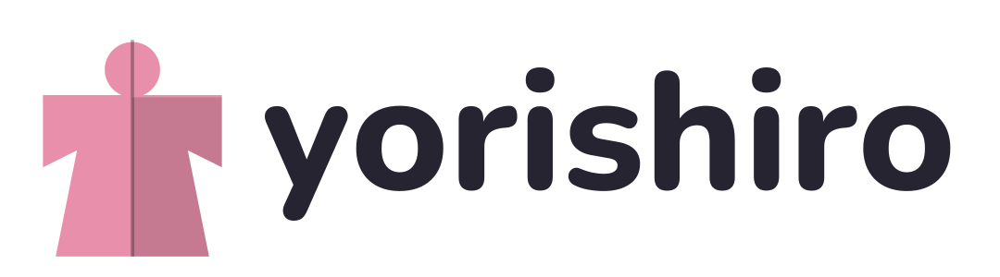
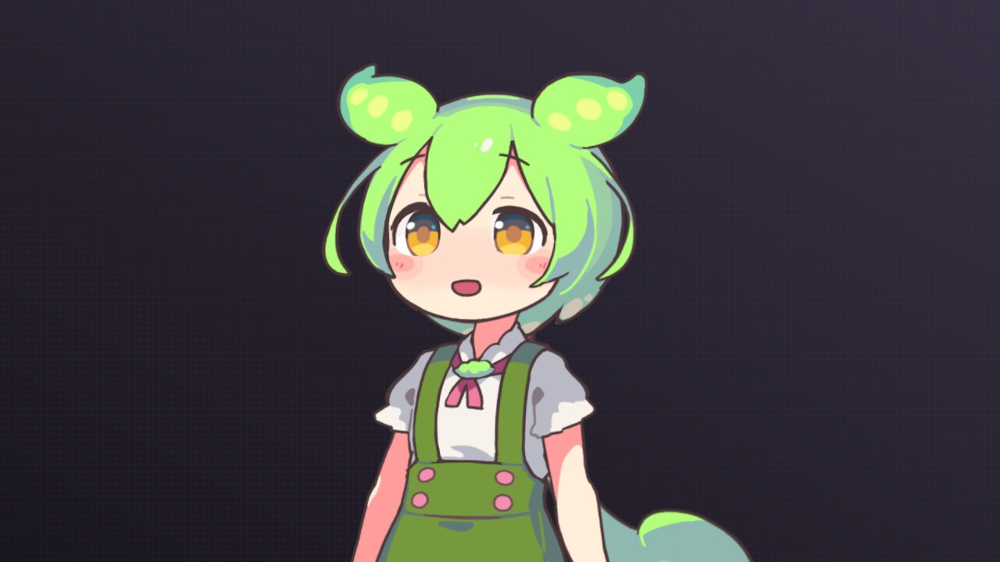
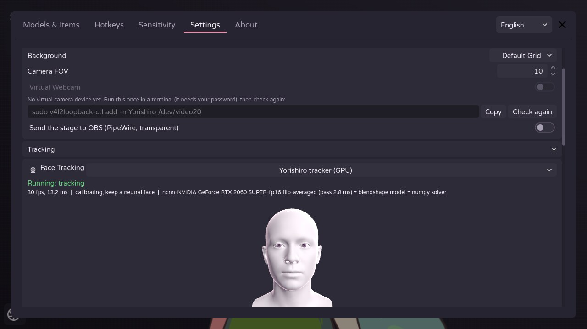
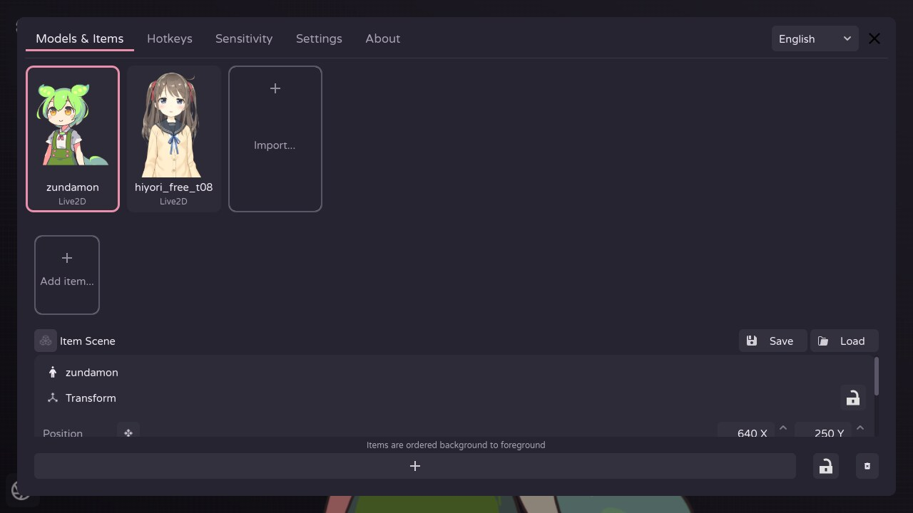
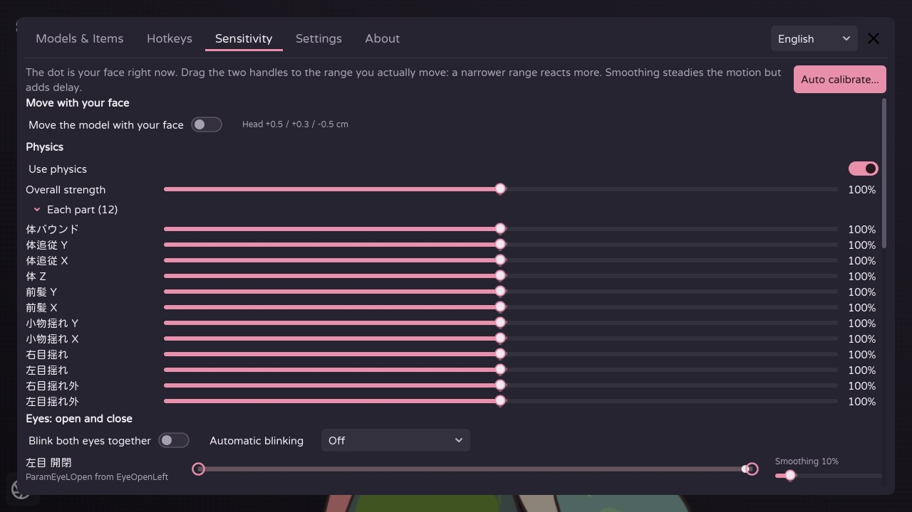
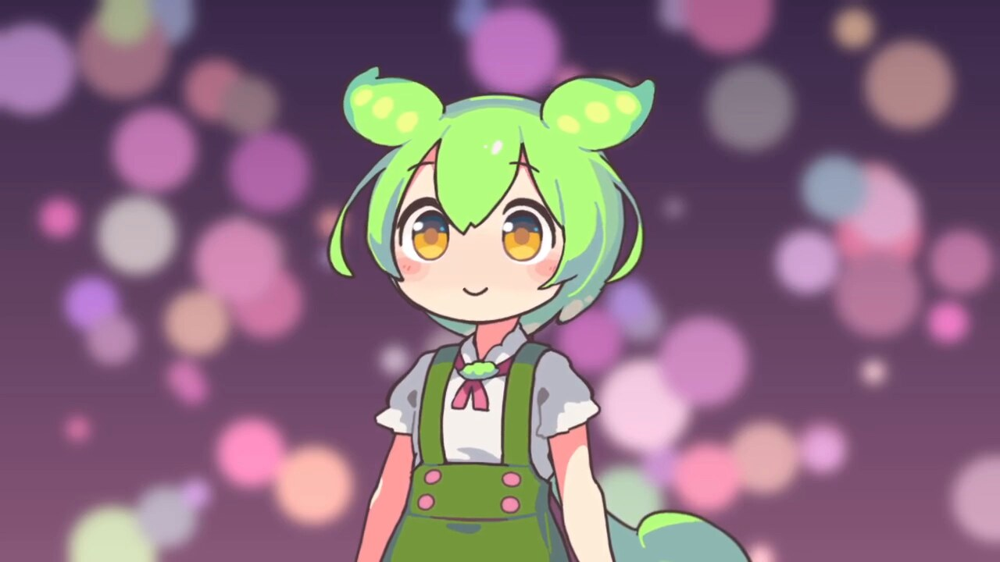

<p align="center">
  <picture>
    <source media="(prefers-color-scheme: dark)" srcset="docs/images/logo-wordmark-dark.png">
    
  </picture>
</p>

<p align="center">給 Linux 的 Live2D VTuber 軟體，內建自己的 GPU 臉部追蹤。</p>

<p align="center"><a href="README.md">English</a></p>



> Yorishiro 還在開發初期，功能和設定格式都可能變動。

## 功能

- **Live2D 模型。** 模型會連同它通常附帶的設定一起載入（參數綁定、熱鍵、物理、待機動畫）。渲染使用獨立的 Live2D 渲染器 [Ayagami](https://github.com/AyagamiDev/ayagami)，不包含
  Live2D Cubism SDK。
- **內建臉部追蹤。** App 會自己啟動追蹤器：MediaPipe FaceMesh 特徵點對應到 ARKit 的 52 種表情；用合成眼睛訓練的
  眼睛模型，戴著會反射螢幕的眼鏡也抓得到眨眼；還有視線和頭部位置。任何顯示卡都能透過 Vulkan 執行，NVIDIA 可用
  CUDA 或 TensorRT，也能只用 CPU。
- **畫面上不出現攝影機影像。** 用一顆 3D 光頭顯示追蹤器看到的表情，就算不小心把設定視窗開在直播上，也不會露出房間。
  偵測到你戴眼鏡時，光頭也會戴上眼鏡。
- **依你的臉調整模型。** 引導式校正、每個參數的範圍和平滑、雙眼一起眨、自動眨眼、模型跟著臉移動、追蹤不到臉時的行為、
  各部位的物理強度。
- **熱鍵、表情和道具。** 熱鍵清單與畫面按鈕、表情切換、Live2D 姿勢群組、圖片和動畫的道具庫、道具場景。
- **透明背景送進 OBS。** 舞台以帶透明度的 PipeWire 影像串流送到 OBS，不含 app 的按鈕和選單。也支援 v4l2loopback
  虛擬攝影機和透明視窗。
- **把追蹤資料給其他軟體。** 追蹤器也能用常見的臉部追蹤協定送出資料（iFacialMocap，以及其他 VTuber 軟體
  讀取的 iPhone 追蹤協定）。
- **英文與繁體中文介面。**

| | |
|---|---|
|  |  |
| 臉部追蹤設定。3D 光頭跟著你的表情動，攝影機畫面不會出現。 | 模型與道具，縮圖直接從舞台截取。 |
|  |  |
| 靈敏度、跟著臉移動、各部位物理。 | 透過 PipeWire 送進 OBS，模型以外是透明的。 |

## 需求

- x86_64 的 Linux，支援 Vulkan 的顯示卡（AMD、Intel 用 Mesa 驅動，NVIDIA 用官方驅動）。
- 網路攝影機。
- 用 PipeWire 送到 OBS：建置需要 PipeWire 1.4 以上（NVIDIA 執行時需要 1.2 以上），OBS 31 以上並安裝
  [obs-pwvideo](https://github.com/hoshinolina/obs-pwvideo) 外掛。

## 建置

App 使用 Ayagami 專案發布、加上混合模式修補的 Godot 4.7.1。

1. **引擎。** 從 [AyagamiDev/ayagami-gd](https://github.com/AyagamiDev/ayagami-gd/releases/tag/godot) 的 `godot`
   release 下載 `godot.linuxbsd.editor.x86_64.llvm` 並核對 sha256。`run.sh` 會在 repo 旁邊的 `../tools/godot/`
   找它，也可以用 `GODOT=/path/to/godot` 指定。
2. **系統套件**（Debian / Ubuntu 名稱）：
   `sudo apt install libudev-dev libinput-dev libclang-dev pkg-config meson ninja-build libpipewire-0.3-dev libgbm-dev libdrm-dev libegl-dev libgl-dev libx11-dev`
3. **Rust** 1.94 以上，用 [rustup](https://rustup.rs) 安裝（發行版的套件通常太舊）。
4. **原生擴充：**
   ```sh
   git submodule update --init
   cd app && ./build_dependencies.sh && cd ..
   ```
5. **追蹤器**（用 [uv](https://docs.astral.sh/uv/) 管理 Python 3.12 環境）：
   ```sh
   cd tracker
   uv sync                                   # CPU 與 Vulkan
   uv run python tools/export_mediapipe.py   # 下載並轉換臉部模型
   # 只有 NVIDIA：CUDA 與 TensorRT 放在另一個環境，app 會優先使用
   UV_PROJECT_ENVIRONMENT=.venv-nvidia uv sync --no-group ort-cpu --group ort-nvidia
   cd ..
   ```
6. **PipeWire 輸出小幫手：** `app/native/funnel_out/build.sh`
7. **第一次匯入專案：** `../tools/godot/godot.linuxbsd.editor.x86_64.llvm --headless --path app --import`

## 使用

```sh
./run.sh
```

- 第一次開啟時，舞台中央會有一張卡片帶你完成：選擇模型、確認臉部追蹤、擺好模型。
- Live2D 模型是一個有 `.model3.json` 檔的資料夾。模型附帶的設定只會讀取，不會被改寫。放在
  `userdata/yorishiro/Live2DModels/` 的模型會自動出現。
- 追蹤器會跟著 app 啟動。開始時請放鬆、看著鏡頭一下，讓它記下你的自然表情，或在「靈敏度」頁使用「自動校正」。
- 拖曳模型可以移動，滾輪調整大小，Shift + 滾輪旋轉。角落的齒輪打開所有設定。
- **OBS：** 在「設定」打開「把舞台傳到 OBS」，再到 OBS 新增「PipeWire video」來源並選 Yorishiro。
- 從原始碼執行時，app 的資料（設定、模型庫、縮圖）放在 `userdata/yorishiro/`。

## Repo 結構

| 資料夾 | 內容 | 授權 |
|--------|------|------|
| `app/` | Yorishiro app（Godot）。最初 fork 自 erodozer 的 [OpenVT](https://github.com/erodozer/open-vt)，包含我們維護的 [ayagami-gd](https://github.com/AyagamiDev/ayagami-gd) 與 [libfunnel](https://github.com/hoshinolina/libfunnel) | MIT，見 `app/LICENSE.txt` |
| `tracker/` | 臉部追蹤引擎 `yorishiro-tracker`（輸出 ARKit 52、可替換模型、Vulkan / CPU / CUDA / TensorRT） | Apache-2.0，見 `tracker/LICENSE` |
| `tools/` | 開發與測試工具 | 跟隨所屬的部分 |

測試用的臉部錄影和模型放在 repo 之外，不會提交。

Yorishiro 是獨立的專案，不是上游的 OpenVT、Ayagami 或 libfunnel，也未經它們的作者背書；問題請回報到這裡。
完整授權與第三方清單：[NOTICE](NOTICE)。

## 截圖使用的素材

截圖中的模型是 Live2D 的範例模型ずんだもん（插畫：坂本アヒル，建模：Live2D Inc.）。
本作品のキャラクターには株式会社Live2Dの著作物であるサンプルデータが株式会社Live2Dの定める規約に従って用いられています。
ずんだもん：東北ずん子・ずんだもんプロジェクト。模型檔案不在這個 repo 裡，請到
[Live2D 的範例頁面](https://www.live2d.com/learn/sample/zundamon/)下載。

「Live2D」和「Cubism」是 Live2D Inc. 的商標。Yorishiro 與 Live2D Inc. 沒有關係。
