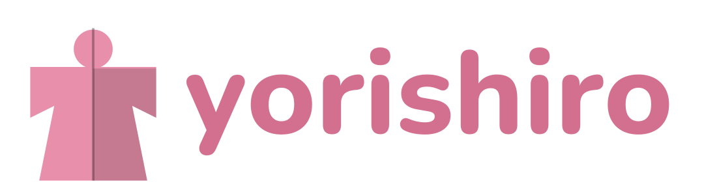

<p align="center">
  
</p>

<p align="center">Linux 上的 Live2D VTuber 軟體，自帶 GPU 臉部追蹤。</p>

<p align="center"><a href="README.md">English</a></p>


> Yorishiro 還在早期開發階段，功能和設定檔格式之後都可能會改。

## 功能

- **Live2D 模型。** 載入模型時會一併讀取它附帶的設定，像是參數綁定、熱鍵、物理和待機動畫。渲染用的是 Katashiro，
  它是我們從獨立開發的 Live2D 渲染器 [Ayagami](https://github.com/AyagamiDev/ayagami) 的 Godot 擴充分支出來的版本，沒有用到 Live2D Cubism SDK。
- **內建臉部追蹤。** 打開 app 就會自動啟動追蹤器。它用 MediaPipe FaceMesh 抓臉部特徵點，換算成 ARKit 的 52 種表情，
  也會追蹤視線和頭部位置。眨眼由一個用合成眼睛圖片訓練的模型判斷，就算眼鏡反射螢幕光也抓得到。各家顯示卡都能透過
  Vulkan 執行，沒有顯示卡的話用 CPU 也行。
- **手部追蹤。** 可以選擇打開，和臉部在同一張顯示卡上一起跑。會追蹤手的位置、角度、張開程度和每根手指，
  給有手部骨架的 Live2D 模型使用。
- **不會出現攝影機畫面。** 追蹤狀態是用一顆 3D 光頭來顯示，就算直播時不小心打開設定，也不會讓觀眾看到你的房間。
  你戴眼鏡的時候，光頭也會跟著戴上。打開手部追蹤時，旁邊還會出現一雙黏土手。
- **依照你的臉調整模型。** 有引導式校正，每個參數都能調範圍和平滑度，另外還有雙眼同步眨眼、自動眨眼、模型跟著臉移動、
  追蹤不到臉時要怎麼處理，以及各部位的物理強度。
- **熱鍵、表情和道具。** 熱鍵清單和畫面按鈕、切換表情、Live2D 姿勢群組、放圖片和動畫的道具庫，還有道具場景。
- **透明背景直接進 OBS。** 舞台畫面會透過 PipeWire 帶著透明度傳到 OBS，不會拍到 app 的按鈕和選單。也可以用
  v4l2loopback 虛擬攝影機，或是把視窗設成透明。
- **追蹤資料也能給其他軟體用。** 追蹤器可以用常見的臉部追蹤協定送出資料，包括 iFacialMocap，以及其他 VTuber
  軟體支援的 iPhone 追蹤協定。
- **外掛。** 提供本機的 WebSocket API（連接埠 8001，預設關閉），訊息格式和現有的 VTuber 外掛相同。外掛可以移動模型、
  觸發熱鍵和表情、送入追蹤數值。每個外掛第一次連線前都會先問過你。
- **介面支援英文和繁體中文。**

| | |
|---|---|
|  |  |
| 臉部追蹤設定。3D 光頭會跟著你的表情動，攝影機畫面不會出現在螢幕上。 | 模型和道具，縮圖直接從舞台截取。 |
|  |  |
| 靈敏度、跟著臉移動，以及各部位的物理。 | 透過 PipeWire 傳進 OBS，模型以外的地方都是透明的。 |

## 系統需求

- x86_64 的 Linux，以及支援 Vulkan 的顯示卡（AMD 和 Intel 用 Mesa 驅動，NVIDIA 用官方驅動）。
- 網路攝影機。
- 想透過 PipeWire 傳到 OBS 的話：編譯時需要 PipeWire 1.4 以上（NVIDIA 執行時需要 1.2 以上），OBS 要 31 以上，
  並裝好 [obs-pwvideo](https://github.com/hoshinolina/obs-pwvideo) 外掛。

## 編譯

1. **引擎。** 下載官方的 [Godot 4.7.2](https://godotengine.org/download/archive/4.7.2-stable/) Linux 版編輯器
   （x86_64，標準版，不是 .NET 版），解壓到 repo 旁邊的 `../tools/godot/`（`run.sh` 預設會到這裡找），
   也可以用 `GODOT=/path/to/godot` 指定位置。
2. **系統套件**（以 Debian / Ubuntu 的套件名稱為例）：
   `sudo apt install libudev-dev libinput-dev libclang-dev pkg-config cmake meson ninja-build libpipewire-0.3-dev libgbm-dev libdrm-dev libegl-dev libgl-dev libx11-dev`
3. **Rust** 1.94 以上。建議用 [rustup](https://rustup.rs) 安裝，發行版內建的版本通常太舊。
4. **原生擴充：**
   ```sh
   git submodule update --init
   cd app && ./build_dependencies.sh && cd ..
   ```
   第一次建置時也會順便建置 [ncnn](https://github.com/Tencent/ncnn)（顯示卡運算用，大約 5 分鐘），並下載
   [ONNX Runtime](https://github.com/microsoft/onnxruntime) 的 CPU 版。
5. **追蹤模型**放在 `models/`（說明見 `models/README.md`）。在正式版附上模型之前，先用研究工具從原始檔案產生
   （Python 3.12 環境由 [uv](https://docs.astral.sh/uv/) 管理）：
   ```sh
   cd research
   uv sync
   uv run python tools/export_mediapipe.py   # 臉部模型
   uv run python tools/export_hands.py       # 手部模型
   uv run python tools/export_fit.py         # ARKit 表情換算資料
   cd ..
   ```
6. **PipeWire 輸出程式：** `native/funnel_out/build.sh`
7. **第一次使用前先匯入專案：** `./run.sh --headless --import`

## 使用方式

```sh
./run.sh
```

- 第一次打開時，舞台中間會出現一張引導卡片，帶你選模型、確認臉部追蹤、把模型擺好。
- Live2D 模型就是一個含有 `.model3.json` 的資料夾。模型附帶的設定只會讀取，不會被修改。放進
  `userdata/yorishiro/Live2DModels/` 的模型會自動出現在清單裡。
- 追蹤器會跟著 app 一起啟動。剛開始請放鬆表情、看著鏡頭幾秒，讓它記住你平常的樣子。也可以到「靈敏度」頁按「自動校正」。
- 拖曳模型可以移動，滾輪縮放，按住 Shift 再滾滾輪可以旋轉。點角落的齒輪可以打開所有設定。
- **OBS：** 在「設定」裡打開「把舞台傳到 OBS」，再到 OBS 新增「PipeWire video」來源，選擇 Yorishiro。
- 從原始碼執行時，app 的資料（設定、模型庫、縮圖）會存在 `userdata/yorishiro/`。

## Repo 結構

| 資料夾 | 內容 | 授權 |
|--------|------|------|
| `app/` | Yorishiro app（Godot）。最早是從 erodozer 的 [OpenVT](https://github.com/erodozer/open-vt) fork 出來的 | MIT，見 `app/LICENSE.txt` |
| `crates/tracking`、`crates/tracking-gd` | Rust 寫的臉部追蹤核心，以及給 Godot 用的節點 | Apache-2.0，見 `crates/tracking/LICENSE` |
| `crates/katashiro`、`crates/katashiro-gd` | Live2D 渲染器 Katashiro：我們從 [Ayagami](https://github.com/AyagamiDev/ayagami) 和它的 Godot 擴充分支出來的版本 | 核心是 MIT 或 Apache-2.0，Godot 部分是 MIT |
| `native/` | 把舞台透過 PipeWire 傳到 OBS 的小程式 | MIT |
| `thirdparty/` | 我們一起編譯的上游程式：[libfunnel](https://github.com/hoshinolina/libfunnel)、godot-keylogger、gd-virtualcamera | 依各自的授權 |
| `models/` | 追蹤用的模型（自己產生或下載，git 裡只有眼睛模型） | 見 `models/README.md` |
| `research/` | 產生追蹤模型的 Python 工具，以及眼睛模型的訓練 | Apache-2.0，見 `research/LICENSE` |
| `tools/` | 開發和測試用的工具 | 依所屬的部分而定 |

測試用的臉部錄影和模型都放在 repo 外面，不會被提交。

Yorishiro 是獨立的專案，和上游的 OpenVT、Ayagami、libfunnel 是不同的專案，也沒有經過它們作者的背書。遇到問題請在這裡回報。
完整的授權和第三方元件清單請見 [NOTICE](NOTICE)。

## 截圖素材

截圖裡的模型是 Live2D 官方的範例模型ずんだもん（插畫：坂本アヒル，建模：Live2D Inc.）。
本作品のキャラクターには株式会社Live2Dの著作物であるサンプルデータが株式会社Live2Dの定める規約に従って用いられています。
ずんだもん：東北ずん子・ずんだもんプロジェクト。模型檔案沒有放在這個 repo 裡，請到
[Live2D 的範例頁面](https://www.live2d.com/learn/sample/zundamon/)下載。

「Live2D」和「Cubism」是 Live2D Inc. 的商標。Yorishiro 和 Live2D Inc. 沒有任何關係。
